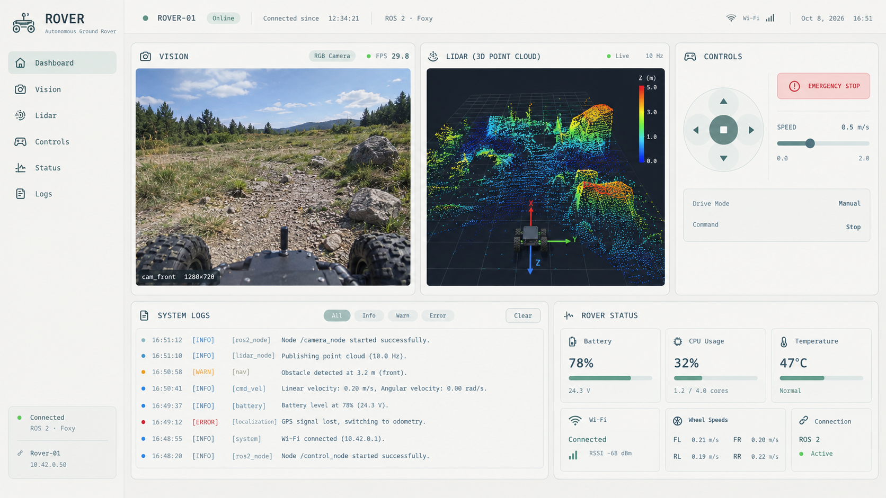
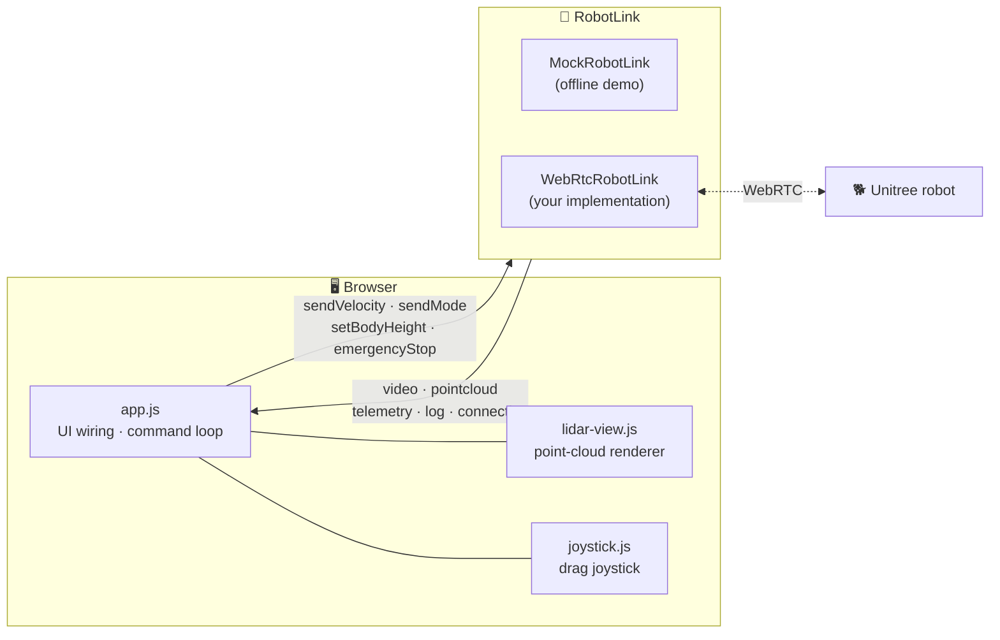

<div align="center">


# Rover Teleop Dashboard

**A browser cockpit for driving a Unitree quadruped: live video, a 3D lidar point cloud, telemetry and controls on one screen.**

<p>
  
  
  
  
  
</p>

<a href="#-quick-start">Quick start</a> •
<a href="#-features">Features</a> •
<a href="#-going-live">Going live</a> •
<a href="#-deploy-to-the-jetson">Deploy</a> •
<a href="#%EF%B8%8F-keyboard-controls">Controls</a>

<br /><br />



<sub><i>Dashboard design: camera feed · 3D lidar · drive controls · system logs · rover status</i></sub>

</div>

---

## ✨ Features

<table>
  <tr>
    <td width="50%" valign="top">
      <h3>📷 Vision</h3>
      Any number of camera feeds, delivered as real <code>MediaStream</code>s. Each camera panel has a dropdown to pick the feed.
    </td>
    <td width="50%" valign="top">
      <h3>🛰️ Lidar point cloud</h3>
      A 3D point cloud drawn on a 2D canvas with an orbit camera. It needs no WebGL and no libraries.
    </td>
  </tr>
  <tr>
    <td valign="top">
      <h3>🎮 Controls</h3>
      A drag joystick, D‑pad, speed slider, posture modes (Stand · Lie down · Balance · Recover), body height and a big red <b>Emergency Stop</b>.
    </td>
    <td valign="top">
      <h3>📊 Telemetry and logs</h3>
      Battery, CPU, motor temperature, network RTT/RSSI and leg contacts. The log stream can be filtered by Info / Warn / Error.
    </td>
  </tr>
  <tr>
    <td valign="top">
      <h3>🛡️ Safe by default</h3>
      Velocity is sent only while <b>Armed</b>. Releasing the joystick, losing window focus or hiding the tab zeroes the command.
    </td>
    <td valign="top">
      <h3>📱 Responsive</h3>
      Works from 320px phones up to wide desktop monitors. Every view can be linked directly with a URL hash.
    </td>
  </tr>
</table>

---

## 🚀 Quick start

ES modules don't load from `file://`, so serve the folder with any static server:

```sh
python3 -m http.server 8765
```

| URL | What you get |
| --- | --- |
| `http://localhost:8765` | Dashboard, then press **Connect** |
| `http://localhost:8765/?demo` | Auto-connects to the built-in **mock robot** |
| `http://localhost:8765/?demo&cams=2` | Mock with a front and a rear camera, to preview the multi-camera layout |
| `http://localhost:8765/?demo#controls` | Opens a view directly: `#vision` `#lidar` `#controls` `#status` `#logs` |

> [!TIP]
> **The Controls view is the driving screen.** It shows the main camera on the left, the controls in the middle, and the second camera on the right when the robot has 2+ cameras (otherwise the lidar).

---

## 🧭 Architecture

The UI never talks to WebRTC, ROS or the Unitree SDK directly. **`RobotLink` is the only point of contact with the robot.**



### 📁 Project structure

```text
TeleOP-Robots/
├── index.html          # Markup for all panels
├── css/
│   └── styles.css      # Design tokens + responsive layout (320px → wide desktop)
├── js/
│   ├── app.js          # UI wiring: connection, controls, command loop, telemetry, logs (CONFIG at top)
│   ├── robot-link.js   # RobotLink interface + MockRobotLink (the only robot-facing code)
│   ├── lidar-view.js   # Point-cloud renderer (2D canvas, orbit camera)
│   └── joystick.js     # Drag joystick
├── assets/
│   └── logo.svg        # Placeholder logo
├── deploy.sh           # Push to the Jetson over SSH
└── Dashboard_Design.png
```

---

## 🔌 Going live

1. Write a class that extends `RobotLink`. The full contract is documented at the top of [`js/robot-link.js`](js/robot-link.js).
2. Swap it in at the top of [`js/app.js`](js/app.js):

   ```js
   const link = new WebRtcRobotLink(/* signaling url, etc. */);
   ```

3. Once the robot model is fixed, update `CONFIG` (name, speed and yaw limits) and the posture modes in `index.html`.

<details>
<summary><b>📡 Events your link emits</b></summary>
<br />

| Event | Payload | Notes |
| --- | --- | --- |
| `connection` | `{ state, transport?, since?, reason? }` | `disconnected` · `connecting` · `connected` · `failed` |
| `video` | `{ id, name, label, stream, width?, height? }` | One event per camera, with the stream from `RTCPeerConnection.ontrack`. `stream: null` means the camera went away |
| `pointcloud` | `{ points: Float32Array, stamp }` | xyz in metres, robot frame (x fwd, y left, z up) |
| `telemetry` | `{ battery, cpu, temperature, network, legs, velocity, mode }` | Every field is optional |
| `log` | `{ level, source, message, time }` | `info` · `warn` · `error` |

</details>

<details>
<summary><b>🕹️ Commands the UI calls</b></summary>
<br />

| Method | When |
| --- | --- |
| `connect()` / `disconnect()` | Connect button |
| `sendVelocity({ vx, vy, wz })` | **20 Hz while armed.** Treat it as a heartbeat and stop the robot if it goes quiet |
| `sendMode(mode)` | Posture: `stand_up` · `lie_down` · `balance` · `recovery` · `damp` |
| `setBodyHeight(offsetMeters)` | Body height slider |
| `emergencyStop()` | E-stop button / <kbd>Esc</kbd> |

</details>

<details>
<summary><b>⚙️ CONFIG</b> (<code>js/app.js</code>)</summary>
<br />

```js
const CONFIG = {
  robotName: 'ROVER-01',
  model: 'Unitree · model TBD',
  maxSpeed: 1.5,        // m/s, upper bound of the speed slider
  maxYawRate: 1.5,      // rad/s at full stick
  strafeRatio: 0.6,     // lateral speed as a fraction of max speed
  commandHz: 20,
};
```

</details>

---

## 📦 Deploy to the Jetson

`deploy.sh` copies the dashboard to the robot's Jetson over SSH. It uses `rsync` when available, falls back to `scp`, and never deletes anything on the remote.

```sh
./deploy.sh            # copy files
./deploy.sh --serve    # copy files, then (re)start the web server on the Jetson
```

You can override the defaults with environment variables:

| Variable | Default |
| --- | --- |
| `REMOTE_USER` | `aisense-jetson3` |
| `REMOTE_HOST` | `100.100.1.1` |
| `REMOTE_DIR` | `/home/aisense-jetson3/Desktop/rover` |
| `PORT` | `8765` |

```sh
REMOTE_HOST=100.100.1.2 ./deploy.sh --serve
```

---

## ⌨️ Keyboard controls

<div align="center">

| Keys | Action |
| :---: | :--- |
| <kbd>W</kbd> / <kbd>S</kbd> | Forward / back |
| <kbd>A</kbd> / <kbd>D</kbd> | Turn left / right |
| <kbd>Q</kbd> / <kbd>E</kbd> | Strafe left / right |
| <kbd>Space</kbd> | Stop |
| <kbd>Esc</kbd> | **Emergency stop** |

</div>

> [!IMPORTANT]
> Velocity commands go out **only while Armed**. Releasing the joystick, losing window focus or hiding the tab immediately zeroes the command.

---

## 📄 License

Released under the [Apache License 2.0](LICENSE).

<div align="center">
<sub>Built for remote operation of quadruped robots 🐾</sub>
</div>
